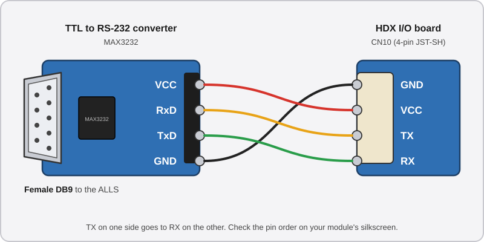

# 📺 Step 2: The Display and the HDX Touchscreens

The screens change little from FiNALE to DX: **you can keep them**. The touchscreens, on the other hand, are radically different and **must be replaced** to run DX.

## The screens

??? note "Click here for the technical explanation"
    There are actually few differences between the screens, and the ones from a FiNALE cabinet can be reused to run DX.

    The main change is the size: FiNALE screens measure **42"**, DX screens **43"**. The difference is not noticeable in-game.

    In both cases, the screens have a native resolution of **1920x1080 at 60 Hz**. What differs is the connectivity on the system side:

    * **RingEdge 2 (FiNALE):** both screens connect over DVI.
    * **ALLS (DX):** HDMI for player 1, DVI for player 2.

    On the screens themselves, the connection is **DVI** in every case.

    If the screens in your cabinet work, there is no reason to replace them.

The official DX manual requires a specific connection. *(Reference: [page 128](../resources/pdfs/maimai-dx-instruction-manual-full.pdf))*

* **Player 1 (P1):** can be connected to the **HDMI** or **DisplayPort** port (the [official manual](../resources/pdfs/maimai-dx-instruction-manual-full.pdf) recommends HDMI).
* **Player 2 (P2):** must be connected to the **DVI** port.

As mentioned in [step 1](step-1-alls-and-psu.md), some FiNALE cabinets were modified by their operator to connect both screens over **DVI** instead of VGA, which is how they originally shipped. If that is your case, you can **reuse the DVI cable** for the player 2 screen. Otherwise, you will need **an HDMI to DVI cable** (player 1) and **a DVI to DVI cable** (player 2).

## The touchscreens

??? note "Click here for the technical explanation"
    With the move to DX, the touchscreen was completely redesigned. Besides the technical improvements of the new model, it goes from **17 zones** on FiNALE to **34 zones** on DX. That difference alone is enough to make the original panel incompatible.

    !!! lightbox
        
        

    The connectivity changes as well:

    * **FiNALE:** both panels are connected to the same controller, which is wired over DB9 to the RingEdge 2.
    * **DX:** each panel has its own dedicated controller, wired to its own DB9 on the ALLS.

    Both models have the same dimensions, and most community-made panels also follow this standard. It is therefore possible to replace a FiNALE panel with a DX one **without adapting the chassis**.

It is practically impossible to get an official DX touchscreen, so you have to turn to **community-made alternatives**:

* **HanDevice's HDX:** *the choice recommended by this guide*. Installation is much simpler thanks to its **UART** connector.
* **yuancon's ADX:** a possible alternative, but it only connects over **USB-CDC**. You then need an external device and a complex setup to extract that signal to a DB9 connector.

### Replacing the panel

1. **Remove the front of the cabinet.** To reach the panel, take off the plastic fascia *and* the metal frame fixed around the screen.
2. **Remove the old panel.** It is held from the inside by **8 screws**. Also remove any associated wiring if it is still in place: it will not be reused. (Keep the button wiring, however.)
3. **Install the new panel** and secure it with the 8 screws.

    !!! lightbox
        ](../resources/images/step-2-touchscreen-display/hdx-panel-clips-removal.jpg)

You then have to connect the panel to the ALLS, depending on the model you chose.

??? example "The easy way: HDX"
    ### The easy way: HDX

    The original controller of the HDX panel has a **UART port**: it therefore connects to the ALLS very simply, with only a few light adjustments.

    #### Enabling the UART port

    Unlike other conversion kits, the HanDevice I/O board supplied with the HDX panels exposes a UART serial port directly. However, **it is not enabled by default**: this port is originally dedicated to the HDX's internal Aime reader.

    1. **Enable the feature** from HanDevice's **configuration website** (see [HanDevice's official documentation]({{HANDEVICE_OFFICIAL_DOCUMENTATION}})).
    2. **Locate the CN10 connector** on the I/O board. It has four pins and will now send the touch signals over UART.

    Once the feature is enabled, the **HDX's emulated Aime reader stops working**. This is not a problem: we install a real Aime reader separately in this guide (see [step 3](step-3-aime-reader.md)).

    !!! info "Logic level, not RS-232"
        This port outputs **raw UART** (TTL logic levels), while the ALLS expects **RS-232**. A **UART to RS-232** converter module is therefore needed before the DB9 connector, which the next section covers. (See [Understanding serial protocols](understanding-serial-protocols.md))

    #### Connecting the DB9 adapter

    The **TTL to RS-232 converter** from the [shopping list](equipment.md#electronics) does the translation: it connects to the I/O board on one side, and to the ALLS on the other through its **female DB9** plug. This part has to be repeated **for each panel** (player 1 and player 2).

    ##### 1. Make the cable to the converter

    Make a small **4-wire** cable linking the I/O board's **CN10** to the converter's **TTL side**. It does not need to be long: the converter will stay next to the I/O board.

    * **I/O board side:** crimp the wires with **JST-SH female** pins and insert them in a **4-pin JST-SH** connector, in the pinout order:

        !!! lightbox wide
            ](../resources/images/step-2-touchscreen-display/hdx-cn10-uart-pinout.jpg)

    * **Converter side:** connect the other end of the wires to the module's TTL pins, using crimped female Dupont pins or by soldering directly. **TX on one side goes to RX on the other**:

        { width="90%" }

    The converter is powered by CN10's **VCC**: it needs no external power supply.

    ##### 2. Plugging in

    Plug the JST-SH into the I/O board's **CN10**, then link the converter's female DB9 plug to the ALLS with a **male-female DB9 cable** (the 3 m extensions from the shopping list). Respect each player's port, as explained in the next point.

    !!! warning "HanDevice I/O board power"
        The **I/O board's USB port is only there to power it**: it carries no data here, but it must still be plugged into a **5V power supply**.

        * **There is no need to plug it into the ALLS.**
        * All the touch signals go through **CN10** and the converter: the only link with the ALLS is the converter's **DB9** plug.

    !!! tip "Nothing happens in game?"
        If the panel does not respond once everything is plugged in, swap the TX and RX wires on the converter side: it is the most common crossover mistake.


??? example "Alternative: ADX"
    ### Alternative: ADX

    This solution is **not the one this guide recommends**. It is meant for those who already have ADX panels at hand or cannot buy HDX ones. It requires more hardware, as well as being comfortable with Linux.

    #### Why a Raspberry Pi is needed

    The ADX only speaks **USB-CDC** (see [Understanding serial protocols](understanding-serial-protocols.md)), while the game expects **RS-232 at 9600 baud**. Plugging them together directly, even with a USB to serial adapter, crashes the game for two reasons:

    * **Too fast:** the ADX sends its positions at USB speed, the game receives them in a trickle and ends up overwhelmed.
    * **Too demanding:** the ADX only accepts a command if it arrives *in a single block*. The game, however, sends it in small pieces, so the ADX ignores them.

    A translator is therefore needed between the two: a **Raspberry Pi** running [maitouch_rs]({{MAITOUCH_RS_REPO}}) (based on the work of [4ndr3w]({{GITHUB_4NDR3W}})). It gathers the game's commands before passing them to the ADX, absorbs the ADX's flood of data, and only forwards *the most recent position* to the game at a pace it can digest.

    #### Additional hardware

    * **1x** Raspberry Pi with its power supply (a Pi 3b is enough. Both ADX can share the same Pi)
    * **2x** USB to serial adapters with an **FTDI** chip (one per side)
    * **2x** **null modem** adapters, so that the male/female connectors match those on the ALLS (or directly an FTDI adapter with a female DB9 connector if you can find one)

    #### Setup

    The program does only one thing: link **a serial port to the ALLS** with **a USB port to an ADX**. It is therefore launched **once per player**, with two paths as arguments: `maitouch_rs <port to the ALLS> <port to the ADX>`. The port paths do not matter to it, **but Linux numbers them in an order that can change at every boot** (`/dev/ttyACM0` can become `/dev/ttyACM1`). If the P1 and P2 ports get swapped, so do the players. The first part of the procedure gives each cable a **fixed name**.

    ##### 1. Preparing the Raspberry Pi

    1. **Install** *Raspberry Pi OS Lite* on the SD card with [Raspberry Pi Imager]({{RASPBERRY_PI_IMAGER}}). In the advanced settings, **enable SSH** and choose a username and password. Connect the Pi to your network, you can then control it from your PC with `ssh your-user@raspberrypi.local`.
    2. **Install** the tools required for compilation:

        ```bash
        sudo apt update && sudo apt install -y git build-essential pkg-config libudev-dev curl
        curl --proto '=https' --tlsv1.2 -sSf https://sh.rustup.rs | sh
        ```

        The second program asks a question, simply answer `1` (default installation). Then close your SSH session and reopen it so that the `cargo` command is recognized.
    3. **Compile** the program (allow several minutes, this is normal):

        ```bash
        git clone https://github.com/4ndr3w/maitouch_rs.git
        cd maitouch_rs
        cargo build --release
        sudo cp target/release/maitouch_rs /usr/local/bin/maitouch
        ```

    ##### 2. Giving each cable a fixed name

    Linux can identify a cable by **the Pi USB socket it is plugged into**. As long as you do not move them to another socket, each cable will therefore keep the same name. **Stick a label** on each cable (P1 ADX, P1 to ALLS, P2 ADX, P2 to ALLS), you will need them.

    1. **Unplug everything** from the Pi, except its power supply.
    2. **Plug in a single cable**: the player 1 ADX, in the USB socket of your choice. Display its identifier:

        ```bash
        ls /dev/ttyACM* /dev/ttyUSB*
        udevadm info -q property -n /dev/ttyACM0 | grep ID_PATH=
        ```

        The ADX shows up as `ttyACM`, the FTDI adapters as `ttyUSB`. The second command prints a line that looks like `ID_PATH=platform-xhci-hcd.0-usb-0:1.2:1.0`. **Copy it** into a notepad, noting which cable it corresponds to. If the port is named `ttyACM1` or `ttyUSB0`, adapt the command.
    3. **Repeat** the operation with the three other cables, **one at a time** and in different sockets: the player 1 FTDI adapter (ALLS P1), the player 2 ADX, then the player 2 FTDI adapter (ALLS P2).
    4. **Create** the rules file:

        ```bash
        sudo nano /etc/udev/rules.d/99-maitouch.rules
        ```

        Paste the following four lines, replacing **each quoted value** with the `ID_PATH` of the matching cable (without the leading `ID_PATH=`):

        ```
        SUBSYSTEM=="tty", ENV{ID_PATH}=="ID_PATH_ADX_P1", SYMLINK+="adx-p1"
        SUBSYSTEM=="tty", ENV{ID_PATH}=="ID_PATH_FTDI_P1", SYMLINK+="alls-p1"
        SUBSYSTEM=="tty", ENV{ID_PATH}=="ID_PATH_ADX_P2", SYMLINK+="adx-p2"
        SUBSYSTEM=="tty", ENV{ID_PATH}=="ID_PATH_FTDI_P2", SYMLINK+="alls-p2"
        ```

        To save in `nano`: `Ctrl+O`, `Enter`, then `Ctrl+X` to quit.
    5. **Plug the four cables back in**, then load the rules and check the result:

        ```bash
        sudo udevadm control --reload-rules && sudo udevadm trigger
        ls -l /dev/adx-p1 /dev/alls-p1 /dev/adx-p2 /dev/alls-p2
        ```

        All four names must show up, each with an arrow pointing to a `ttyACM` or a `ttyUSB`. If one is missing, check the matching `ID_PATH` in the file (a single typo is enough).

    ##### 3. Testing

    Connect the FTDI adapters to the ALLS (see [Connecting the device to the ALLS](#connecting-the-device-to-the-alls)), then launch player 1 by hand:

    ```bash
    sudo maitouch /dev/alls-p1 /dev/adx-p1
    ```

    The message **Ports opened** then **Read loop started** must appear. Now start the game: **From ALLS** and **From ADX** lines scroll by, and the panel responds to touch. Stop the test with `Ctrl+C` and start over with `/dev/alls-p2 /dev/adx-p2`. If the program stops with an error, it is usually because one of the two paths does not exist: go back to step 2.

    ##### 4. Launching automatically at startup

    Create **a single** service file that will serve both players:

    ```bash
    sudo nano /etc/systemd/system/maitouch@.service
    ```

    ```ini
    [Unit]
    Description=maitouch touch proxy (%i)
    After=network.target

    [Service]
    ExecStart=/usr/local/bin/maitouch /dev/alls-%i /dev/adx-%i
    Restart=always
    RestartSec=2

    [Install]
    WantedBy=multi-user.target
    ```

    Then enable it for both players:

    ```bash
    sudo systemctl daemon-reload
    sudo systemctl enable --now maitouch@p1 maitouch@p2
    ```

    The `p1` and `p2` after the `@` replace the `%i` in the file, hence the `alls-p1` and `adx-p1` names chosen above. Check that everything is running with `systemctl status maitouch@p1 maitouch@p2`, and reboot the Pi once to confirm the panel works without launching anything by hand. If something goes wrong, `journalctl -u maitouch@p1 -f` shows what the program is doing live.

### Connecting the device to the ALLS

Each side has its own COM port, **do not swap them**: otherwise the game will mix up the two players. *([Manual](../resources/pdfs/maimai-dx-instruction-manual-full.pdf), page 128)*

* **Player 1:** port **COM3**.
* **Player 2:** port **COM4**.

!!! lightbox
    

Once the panels are connected to the ALLS, **the scariest part is over**. The hardest part of the guide is behind us.

---

Let's move on to [Step 3: The Aime Card Reader](step-3-aime-reader.md).
