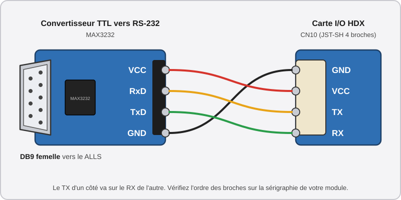
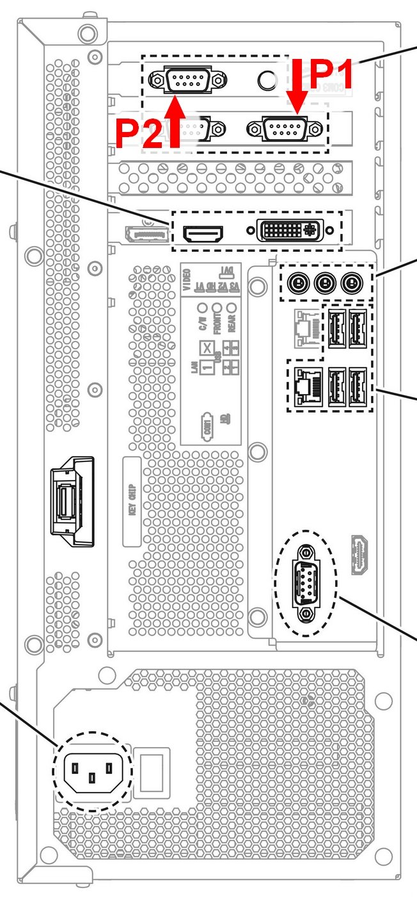

# 📺 Étape 2 : L'Affichage et les Dalles Tactiles HDX

Les écrans changent peu de FiNALE à DX : **vous pouvez les garder**. Les dalles tactiles, en revanche, sont radicalement différentes et **doivent être remplacées** pour faire fonctionner DX.

## Les écrans

??? note "Cliquez ici pour l'explication technique"
    Il y a finalement peu de différences au niveau des écrans, et ceux d'une borne FiNALE peuvent être réutilisés pour faire tourner DX.

    Le principal changement est la taille : les écrans de FiNALE mesurent **42"**, ceux de DX **43"**. La nuance n'est pas perceptible en jeu.

    Dans les deux cas, les écrans affichent une résolution native de **1920x1080 à 60 Hz**. C'est la connectique côté système qui diffère :

    * **RingEdge 2 (FiNALE) :** les deux écrans se connectent en VGA.
    * **ALLS (DX) :** HDMI pour le joueur 1, DVI pour le joueur 2.

    Sur les écrans eux-mêmes, la connexion reste dans tous les cas en **DVI**.

    Si les écrans de votre borne sont fonctionnels, il n'y a aucune raison de les changer.

Le manuel officiel de DX impose un branchement précis. *(Référence : [page 128](../resources/pdfs/maimai-dx-instruction-manual-full.pdf))*

* **Joueur 1 (P1) :** peut être branché sur le port **HDMI** ou **DisplayPort** (le [manuel officiel](../resources/pdfs/maimai-dx-instruction-manual-full.pdf) recommande HDMI).
* **Joueur 2 (P2) :** doit être branché sur le port **DVI**.

Comme mentionné à [l'étape 1](step-1-alls-and-psu.md), certaines bornes FiNALE ont été modifiées par leur exploitant pour connecter les deux écrans en **DVI** plutôt qu'en VGA, comme c'était le cas à l'origine. Si c'est votre cas, vous pouvez **réutiliser le câble DVI** pour l'écran du joueur 2. Sinon, il vous faudra **un câble HDMI vers DVI** (joueur 1) et **un câble DVI vers DVI** (joueur 2).

## Les dalles tactiles

??? note "Cliquez ici pour l'explication technique"
    Au passage à DX, la dalle tactile a été entièrement revue. Outre les améliorations techniques du nouveau modèle, elle passe de **17 zones** sur FiNALE à **34 zones** sur DX. Cette seule différence suffit à rendre la dalle d'origine incompatible.

    !!! lightbox
        
        

    La connectique évolue également :

    * **FiNALE :** les deux dalles sont raccordées au même contrôleur, connecté en DB9 sur le RingEdge 2.
    * **DX :** chaque dalle a son propre contrôleur dédié, raccordé à son propre DB9 sur le ALLS.

    Les deux modèles ont les mêmes dimensions, et la majorité des dalles produites par la communauté respectent également ce standard. Il est donc possible de remplacer une dalle de FiNALE par une dalle de DX **sans adapter le châssis**.

Il est pour ainsi dire impossible d'obtenir une dalle tactile DX officielle, il faut donc se tourner vers les **alternatives produites par la communauté** :

* **HDX de HanDevice :** *le choix recommandé par ce guide*. Son installation est bien plus simple grâce à son connecteur **UART**.
* **ADX de yuancon :** une alternative possible, mais elle ne se branche qu'en **USB-CDC**. Il faut alors un appareil externe et une installation complexe pour extraire ce signal vers un connecteur DB9.

### Remplacer la dalle

1. **Démontez l'avant de la borne.** Pour accéder à la dalle, retirez la façade en plastique *et* la devanture en métal fixée autour de l'écran.
2. **Retirez l'ancienne dalle.** Elle est attachée par l'intérieur via **8 vis**. Enlevez aussi tout le câblage associé s'il est encore en place : il ne sera pas réutilisé. (Conservez toutefois le câblage des boutons.)
3. **Installez la nouvelle dalle** et sécurisez-la avec les 8 vis.

    !!! lightbox
        ](../resources/images/step-2-touchscreen-display/hdx-panel-clips-removal.jpg)

Il reste ensuite à brancher la dalle au ALLS, selon le modèle que vous avez choisi.

??? example "La méthode facile : HDX"

    --8<-- "includes/untested-fr.md"
    
    ### La méthode facile : HDX

    Le contrôleur d'origine de la dalle HDX possède un **port UART** : il se connecte donc très simplement au ALLS, avec seulement quelques aménagements légers.

    #### Activer le port UART

    Contrairement à d'autres kits de conversion, la carte I/O HanDevice fournie avec les dalles HDX expose directement un port série UART. Toutefois, **il n'est pas activé par défaut** : ce port est à l'origine dédié au lecteur Aime interne du HDX.

    1. **Activez la fonction** depuis le **site de configuration** de HanDevice (voir [la documentation officielle de HanDevice]({{HANDEVICE_OFFICIAL_DOCUMENTATION}})).
    2. **Repérez le connecteur CN10** sur la carte I/O. Il comporte quatre broches et enverra désormais les signaux tactiles en UART.

    Une fois la fonction activée, le **lecteur Aime émulé du HDX cesse de fonctionner**. Ce n'est pas un problème : nous installons un véritable lecteur Aime séparément dans ce guide (voir [l'étape 3](step-3-aime-reader.md)).

    !!! info "Niveau logique, pas RS-232"
        Ce port sort de l'**UART brut** (niveaux logiques TTL), alors que le ALLS attend du **RS-232**. Il faut donc un module de conversion **UART vers RS-232** avant le connecteur DB9, ce que traite la section suivante. (Voir [Comprendre les protocoles série](understanding-serial-protocols.md))

    #### Raccorder l'adaptateur DB9

    Le **convertisseur TTL vers RS-232** de la [liste de courses](equipment.md#electronique) fait la traduction : il se branche d'un côté à la carte I/O, et de l'autre, via sa fiche **DB9 femelle**, au ALLS. Cette partie est à refaire **pour chaque dalle** (joueur 1 et joueur 2).

    ##### 1. Confectionner le câble vers le convertisseur

    Fabriquez un petit câble de **4 fils** qui relie le **CN10** de la carte I/O au **côté TTL** du convertisseur. Il n'a pas besoin d'être long : le convertisseur restera à côté de la carte I/O.

    * **Côté carte I/O :** sertissez les fils avec des broches **JST-SH femelle** et insérez-les dans un connecteur **JST-SH 4 broches**, dans l'ordre du brochage :

        !!! lightbox wide
            ](../resources/images/step-2-touchscreen-display/hdx-cn10-uart-pinout.jpg)

    * **Côté convertisseur :** raccordez l'autre extrémité des fils aux broches TTL du module, avec des broches Dupont femelles serties, ou en soudant directement. **Le TX d'un côté va sur le RX de l'autre** :

        { width="90%" }

    Le convertisseur est alimenté par le **VCC** du CN10 : il n'a pas besoin d'alimentation externe.

    ##### 2. Branchement

    Branchez le JST-SH sur le **CN10** de la carte I/O, puis reliez la fiche DB9 femelle du convertisseur au ALLS avec un **câble DB9 mâle-femelle** (les rallonges de 3 m de la liste de courses). Respectez le port de chaque joueur, comme expliqué au point suivant.

    !!! warning "Alimentation de la carte I/O HanDevice"
        Le **port USB de la carte I/O ne sert qu'à l'alimenter** : il ne transmet aucune donnée ici, mais il doit quand même être branché à une **alimentation 5V**.

        * **Il est inutile de le brancher au ALLS.**
        * Tous les signaux tactiles passent par le **CN10** et le convertisseur : le seul lien avec le ALLS est la fiche **DB9** du convertisseur.

    !!! tip "Rien ne se passe en jeu ?"
        Si la dalle ne répond pas une fois tout branché, inversez les fils TX et RX côté convertisseur : c'est l'erreur de croisement la plus fréquente.


??? example "Alternative : ADX"
    ### Alternative : ADX

    Cette solution n'est **pas celle que recommande ce guide**. Elle s'adresse à celles et ceux qui ont déjà des ADX sous la main ou ne peuvent pas acheter de HDX. Elle demande plus de matériel, ainsi que d'être à l'aise avec Linux.

    #### Pourquoi un Raspberry Pi est nécessaire

    L'ADX ne parle qu'en **USB-CDC** (voir [Comprendre les protocoles série](understanding-serial-protocols.md)), alors que le jeu attend du **RS-232 à 9600 bauds**. Les brancher directement, même avec un adaptateur USB vers série, fait planter le jeu pour deux raisons :

    * **Trop rapide :** l'ADX envoie ses positions à la vitesse de l'USB, le jeu les reçoit au compte-gouttes et finit submergé.
    * **Trop exigeant :** l'ADX n'accepte une commande que si elle lui arrive *en un seul bloc*. Or le jeu l'envoie par petits morceaux, l'ADX les ignore donc.

    Il faut donc un traducteur entre les deux : un **Raspberry Pi** qui fait tourner [maitouch_rs]({{MAITOUCH_RS_REPO}}) (basé sur le travail de [4ndr3w]({{GITHUB_4NDR3W}})). Il rassemble les commandes du jeu avant de les passer à l'ADX, absorbe le flot de données de l'ADX, et ne transmet au jeu que *la position la plus récente* à une vitesse qu'il peut digérer.

    #### Matériel supplémentaire

    * **1x** Raspberry Pi avec son alimentation (Un Pi 3b suffit. Les deux ADX peuvent partager le même Pi)
    * **2x** adaptateurs USB vers série à puce **FTDI** (un par côté)
    * **2x** adaptateurs **null modem**, pour que les fiches mâle/femelle correspondent à celles du ALLS (Ou directement un adaptateur FTDI avec une fiche DB9 femelle si vous en trouvez)

    #### Mise en place

    Le programme ne fait qu'une chose : relier **un port série vers le ALLS** à **un port USB vers un ADX**. Il se lance donc **une fois par joueur**, avec deux chemins en paramètre : `maitouch_rs <port vers le ALLS> <port vers l'ADX>`. Le chemin des ports n'a aucune importance pour lui, **mais Linux les numérote dans un ordre qui peut changer à chaque démarrage** (`/dev/ttyACM0` peut devenir `/dev/ttyACM1`). Si les ports P1 et P2 s'inversent, les joueurs aussi. La première partie de la procédure sert à donner à chaque câble un **nom fixe**.

    ##### 1. Préparer le Raspberry Pi

    1. **Installez** *Raspberry Pi OS Lite* sur la carte SD avec [Raspberry Pi Imager]({{RASPBERRY_PI_IMAGER}}). Dans les réglages avancés, **activez SSH** et choisissez un nom d'utilisateur et un mot de passe. Branchez le Pi à votre réseau, vous pourrez alors le contrôler depuis votre PC avec `ssh votre-utilisateur@raspberrypi.local`.
    2. **Installez** les outils nécessaires à la compilation :

        ```bash
        sudo apt update && sudo apt install -y git build-essential pkg-config libudev-dev curl
        curl --proto '=https' --tlsv1.2 -sSf https://sh.rustup.rs | sh
        ```

        Le second programme pose une question, répondez simplement `1` (installation par défaut). Fermez ensuite votre session SSH et rouvrez-la pour que la commande `cargo` soit reconnue.
    3. **Compilez** le programme (comptez plusieurs minutes, c'est normal) :

        ```bash
        git clone https://github.com/4ndr3w/maitouch_rs.git
        cd maitouch_rs
        cargo build --release
        sudo cp target/release/maitouch_rs /usr/local/bin/maitouch
        ```

    ##### 2. Donner un nom fixe à chaque câble

    Linux peut identifier un câble d'après **la prise USB du Pi dans laquelle il est branché**. Tant que vous ne les changez pas de prise, chaque câble gardera donc le même nom. **Collez une étiquette** sur chaque câble (P1 ADX, P1 vers ALLS, P2 ADX, P2 vers ALLS), vous en aurez besoin.

    1. **Débranchez tout** du Pi, sauf son alimentation.
    2. **Branchez un seul câble** : l'ADX du joueur 1, dans la prise USB de votre choix. Affichez son identifiant :

        ```bash
        ls /dev/ttyACM* /dev/ttyUSB*
        udevadm info -q property -n /dev/ttyACM0 | grep ID_PATH=
        ```

        L'ADX apparaît en `ttyACM`, les adaptateurs FTDI en `ttyUSB`. La seconde commande affiche une ligne qui ressemble à `ID_PATH=platform-xhci-hcd.0-usb-0:1.2:1.0`. **Copiez-la** dans un bloc-notes en notant à quel câble elle correspond. Si le port s'appelle `ttyACM1` ou `ttyUSB0`, adaptez la commande.
    3. **Répétez** l'opération avec les trois autres câbles, **un à la fois** et dans des prises différentes : l'adaptateur FTDI du joueur 1 (ALLS P1), l'ADX du joueur 2, puis l'adaptateur FTDI du joueur 2 (ALLS P2).
    4. **Créez** le fichier de règles :

        ```bash
        sudo nano /etc/udev/rules.d/99-maitouch.rules
        ```

        Collez-y les quatre lignes suivantes en remplaçant **chaque valeur entre guillemets** par l'`ID_PATH` du câble correspondant (sans le début `ID_PATH=`) :

        ```
        SUBSYSTEM=="tty", ENV{ID_PATH}=="ID_PATH_ADX_P1", SYMLINK+="adx-p1"
        SUBSYSTEM=="tty", ENV{ID_PATH}=="ID_PATH_FTDI_P1", SYMLINK+="alls-p1"
        SUBSYSTEM=="tty", ENV{ID_PATH}=="ID_PATH_ADX_P2", SYMLINK+="adx-p2"
        SUBSYSTEM=="tty", ENV{ID_PATH}=="ID_PATH_FTDI_P2", SYMLINK+="alls-p2"
        ```

        Pour enregistrer dans `nano` : `Ctrl+O`, `Entrée`, puis `Ctrl+X` pour quitter.
    5. **Rebranchez** les quatre câbles, puis chargez les règles et vérifiez le résultat :

        ```bash
        sudo udevadm control --reload-rules && sudo udevadm trigger
        ls -l /dev/adx-p1 /dev/alls-p1 /dev/adx-p2 /dev/alls-p2
        ```

        Les quatre noms doivent s'afficher, chacun avec une flèche vers un `ttyACM` ou un `ttyUSB`. Si l'un manque, vérifiez l'`ID_PATH` correspondant dans le fichier (une faute de frappe suffit).

    ##### 3. Tester

    Raccordez les adaptateurs FTDI au ALLS (voir [Raccorder le périphérique au ALLS](#raccorder-le-peripherique-au-alls)), puis lancez le joueur 1 à la main :

    ```bash
    sudo maitouch /dev/alls-p1 /dev/adx-p1
    ```

    Le message **Ports opened** puis **Read loop started** doit apparaître. Lancez maintenant le jeu : des lignes **From ALLS** et **From ADX** défilent, et la dalle répond au toucher. Arrêtez le test avec `Ctrl+C` et recommencez avec `/dev/alls-p2 /dev/adx-p2`. Si le programme s'arrête avec une erreur, c'est généralement qu'un des deux chemins n'existe pas : retournez à l'étape 2.

    ##### 4. Lancer automatiquement au démarrage

    Créez **un seul** fichier de service qui servira aux deux joueurs :

    ```bash
    sudo nano /etc/systemd/system/maitouch@.service
    ```

    ```ini
    [Unit]
    Description=Proxy tactile maitouch (%i)
    After=network.target

    [Service]
    ExecStart=/usr/local/bin/maitouch /dev/alls-%i /dev/adx-%i
    Restart=always
    RestartSec=2

    [Install]
    WantedBy=multi-user.target
    ```

    Puis activez-le pour les deux joueurs :

    ```bash
    sudo systemctl daemon-reload
    sudo systemctl enable --now maitouch@p1 maitouch@p2
    ```

    Le `p1` et le `p2` après le `@` remplacent le `%i` du fichier, d'où les noms `alls-p1` et `adx-p1` choisis plus haut. Vérifiez que tout tourne avec `systemctl status maitouch@p1 maitouch@p2`, et redémarrez le Pi une fois pour confirmer que la dalle fonctionne sans rien lancer à la main. En cas de souci, `journalctl -u maitouch@p1 -f` affiche ce que fait le programme en direct.

### Raccorder le périphérique au ALLS

Chaque côté a son propre port COM, **ne les inversez pas** : sinon le jeu confondra les deux joueurs. *([Manuel](../resources/pdfs/maimai-dx-instruction-manual-full.pdf), page 128)*

* **Joueur 1 :** port **COM3**.
* **Joueur 2 :** port **COM4**.

!!! lightbox
    

Une fois les dalles raccordées au ALLS, **la partie la plus effrayante est terminée**. Le plus dur est derrière nous pour la suite du guide.

---

Passons à l'[Étape 3 : Le Lecteur de Cartes Aime](step-3-aime-reader.md).
